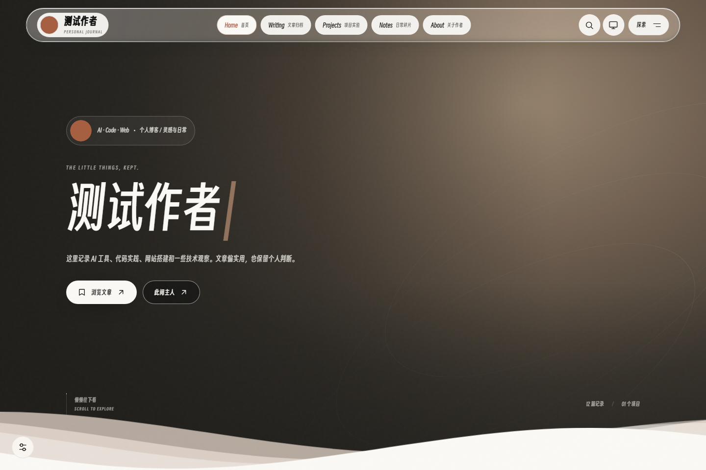

# Akiro_Website

基于 Astro 与 Node.js 的个人博客，提供 Markdown 写作、后台管理、静态发布和独立评论系统。前台保持静态托管，动态功能由 Express 服务提供。


[快速开始](#快速开始) · [配置指南](docs/CONFIGURATION.md) · [部署与备份](docs/DEPLOYMENT.md) · [开发与测试](docs/DEVELOPMENT.md) · [完整更新日志](CHANGELOG.md)

## 界面预览

截图使用隔离环境的虚构数据，仓库默认不包含文章、项目或私人媒体。



<details>
<summary>查看后台登录界面</summary>


</details>

## 功能

| 模块 | 能力 |
| --- | --- |
| 内容 | 文章、随笔、Markdown 预览、草稿、回收站、分类与标签 |
| 阅读 | 归档、客户端搜索、目录、相关文章、划词引用、RSS 与 sitemap |
| 外观 | 五种风格、明暗主题、访客光标设置、本地随机壁纸、移动端与减少动画适配 |
| 管理 | 单管理员登录、媒体库、页面文案、项目、导航、友链、公告及访问统计 |
| 互动 | 独立评论、系统与浏览器展示、审核与回复，后台管理的本地音频和可选网易云曲源 |
| 发布 | 构建日志、静态版本切换、回滚，以及可选私人仓库备份 |

## 快速开始

需要 **Node.js ≥ 22.12.0**，使用 npm 和锁文件安装。以下为 Windows PowerShell 命令。

```powershell
npm ci
if (-not (Test-Path .env)) { Copy-Item .env.example .env }
```

编辑 `.env`，配置 `ADMIN_USER`、`ADMIN_PASSWORD_HASH`、随机 `SESSION_SECRET` 与 `SITE_URL`。密码哈希生成方式见[初始配置](docs/CONFIGURATION.md#初始配置)；真实凭据不要提交到仓库。本地 HTTP 使用 `COOKIE_SECURE=false`。

```powershell
# 终端一：后台与动态 API
npm run admin
# http://localhost:4000/admin
```

```powershell
# 终端二：前台源码预览
npm run dev
# http://localhost:4321
```

登录后台后即可新建文章或随笔。随笔日期必填；文章标题必填。需要检查纯静态产物时运行 `npm run build`，再运行 `npm run preview`。

## 保存与上线

- **保存**：写入待发布的 Markdown 或 JSON；所有前台展示统一在构建发布后更新，开发预览会反映源码变动。
- **构建发布**：后台「构建发布」或 `npm run deploy` 固定输入副本，统一生成页面、公开数据与媒体快照，再切换 `current`；失败保留旧站点。
- **访客写入**：评论、点赞、友链申请和访问打点继续写入运行库，公开展示在下次发布后同步。完整规则见[配置与生效时间](docs/CONFIGURATION.md#配置与生效时间)。
- **回滚**：同时恢复对应版本的页面、公开数据和媒体，不覆盖编辑源文件及评论、访问运行记录。升级后需重启后台并完成一次构建发布。

`npm run dev` 是源码预览，不代表线上已发布。Linux 使用软链接切换；Windows 使用 junction，两次重命名间存在短暂空窗，失败时尝试恢复旧链接。

## 项目文档

| 文档 | 内容 |
| --- | --- |
| [文档索引](docs/README.md) | 按使用场景找到维护说明 |
| [配置指南](docs/CONFIGURATION.md) | 环境变量、内容、外观、项目、音乐与后台操作 |
| [部署与备份](docs/DEPLOYMENT.md) | Linux nginx/systemd、发布、搬迁和恢复 |
| [开发与测试](docs/DEVELOPMENT.md) | 架构、数据目录、内容字段、测试入口和隔离要求 |
| [API 参考](docs/API.md) | 公开接口、认证、管理接口及错误状态 |
| [独立评论系统](docs/COMMENTS.md) | 评论管理、数据库迁移、配置和恢复 |

文章与媒体属于个人数据：`src/content/`、`public/uploads/`、运行时 `data/` 不应公开提交。仓库仅保留基础页面配置；自定义头像和壁纸的备份范围请按部署指南核对。

## 最近更新

### 未发布

- 新增：独立评论、系统/浏览器标签、中文地址与后台 SMTP/站长推送配置。
- 优化：后台编辑、Markdown 导入、项目 AI 辅助、音乐排序、发布版本名称及液态玻璃导航。
- 修复：公告重开、图片上传和回退、连续换页及手机布局，补齐隔离回归。

### V2.4.0

- 新增：统一发布页面、公开数据与媒体快照，媒体库可查看引用位置并跳转编辑。
- 优化：构建使用独立输入副本，回滚同步恢复数据与资源，统一后台生效提示。
- 修复：保存或删除提前影响前台、长时间构建锁误清理及隔离测试退出挂起。

### V2.3.2

- 优化：重组 README 与项目文档，独立维护完整更新日志并保留近期摘要。
- 清理：移除过期报告、执行清单、重复截图及临时文件，统一文档入口与引用。

### V2.3.1

- 修复：随笔日期校验、回滚后的公开文章统计、音乐上传类型与内容校验，以及非法路径的错误状态。
- 优化：UI 回归自动生成隔离数据并复制实体依赖，补齐空博客检查，稳定首次导航等待。

### V2.3.0

- 新增：五种前台风格、官方 Twikoo 评论与后台管理、本地随机壁纸、可调节光标及 GitHub 项目星标自动同步。
- 优化：统一 Akiro 身份与仓库名称，重建首页和内页 UI、动效，采用 Claude 配色、得意黑、液态玻璃与渐进模糊，完善后台交互和配置联动。
- 修复：前后台项目与歌单不一致、关于页悬停刷新、目录跳转、光标手感与弹窗层级、后台选项错位、文字对比度及 Windows 发布与保存问题。

更早版本见[完整更新日志](CHANGELOG.md)。

## 许可证与来源

本项目采用 [MIT License](LICENSE)。开源来源、视觉参考、字体及组件许可见 [第三方声明](THIRD_PARTY_NOTICES.md)；这些声明和随资源分发的许可证需要保留。
