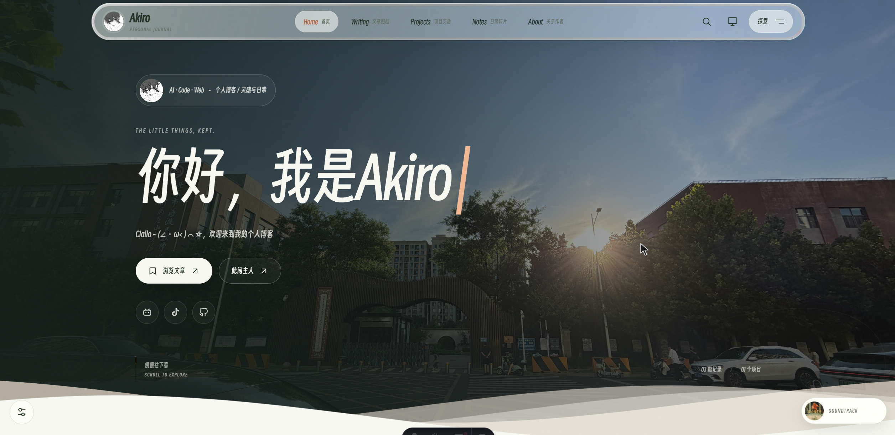
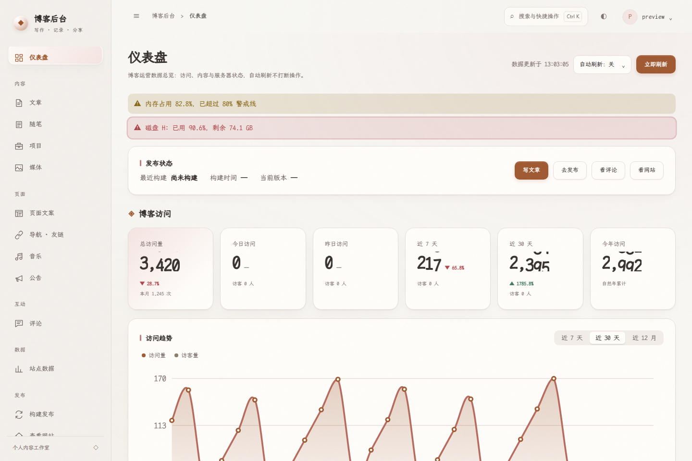
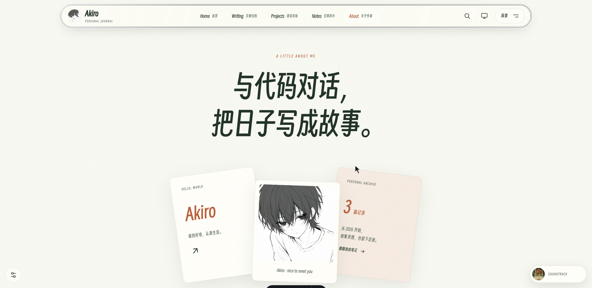
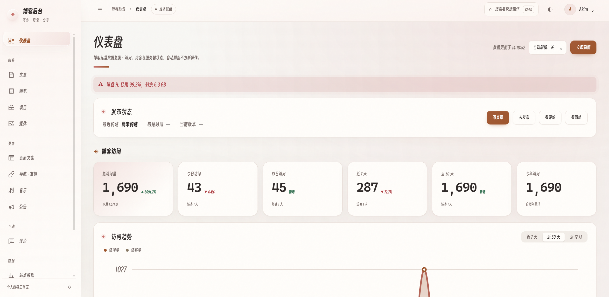

# Akiro_Website

Akiro 的个人博客，源码仓库：[Akiro0814/Akiro_Website](https://github.com/Akiro0814/Akiro_Website)。

<p align="center">
  
  
  
  
</p>

<p align="center"><b>前台首页</b></p>

<p align="center"></p>

<p align="center"><b>后台仪表盘</b></p>

<p align="center"></p>

<p align="center"><b>文章归档</b></p>

<p align="center"></p>

<p align="center"><b>关于页</b></p>

<p align="center"></p>

个人全栈博客：**静态前台 + 后台管理**。前台是纯静态构建产物，后台是一个小型 Node 管理服务，负责登录鉴权、在线编辑 Markdown，并在发布时触发一次前台构建、原子切换上线。

> **基于原作者项目开发**：本项目在 [laogou717/clay-blog](https://github.com/laogou717/clay-blog)（MIT 协议）的基础上改造而成，保留原有内容、评论与音乐能力。前台视觉与动效参考 [RRTiamo/spring_blogs](https://github.com/RRTiamo/spring_blogs)，在 Astro 中重新实现；参考项目的私人内容与专属业务不包含在本项目中。

## 更新日志

### V2.3.1

- 修复：随笔日期校验、回滚后的公开文章统计、音乐上传类型与内容校验，以及非法路径的错误状态。
- 优化：UI 回归自动生成隔离数据并复制实体依赖，补齐空博客检查，稳定首次导航等待。

### V2.3.0

- 新增：五种前台风格、官方 Twikoo 评论与后台管理、本地随机壁纸、可调节光标及 GitHub 项目星标自动同步。
- 优化：统一 Akiro 身份与仓库名称，重建首页和内页 UI、动效，采用 Claude 配色、得意黑、液态玻璃与渐进模糊，完善后台交互和配置联动。
- 修复：前后台项目与歌单不一致、关于页悬停刷新、目录跳转、光标手感与弹窗层级、后台选项错位、文字对比度及 Windows 发布与保存问题。

前台迁移范围见 [迁移说明](docs/SPRING_BLOGS_UI_MIGRATION.md)，设置与生效方式见 [前后台配置说明](docs/FRONT_ADMIN_ALIGNMENT.md)、[本地壁纸](docs/WALLPAPERS.md) 和 [液态玻璃导航](docs/LIQUID_GLASS.md)，测试证据见 [验证记录](docs/SPRING_UI_BROWSER_VALIDATION.md)。

### V2.2.1

- 精简历史更新日志，仅保留各版本的主要改动。

### V2.2.0

- 优化后台视觉与动效，统一为暖色珍珠玻璃风格，改善编辑抽屉、浮层及移动端交互。
- 新增主题、界面密度、侧栏折叠设置与快捷搜索。
- 新增内容看板、状态矩阵、时间轴和关系图，支持列表筛选、分页及 CSV 导出。
- 修复快速切页时的数据覆盖、浮层关闭冲突及今日访问量统计问题。
- 加固 Windows 发布与回滚、并发文件写入，完善跨平台 CI 和后台交互回归检查。

### V2.1.0

- 完善控件标签、表格语义、弹窗键盘操作和明暗主题文字对比度。
- 优化窄屏导航、表格与触摸操作，适配减少动画偏好。
- 统一语义色、间距与空状态样式。
- 修复选中文字引用评论失效、窄屏首页入口不可见、状态徽标竖排及搜索空结果死链。

### V2.0.0

- 改版后台仪表盘，整合访问趋势、来源分布、内容概况与服务器监控。
- 重做文章编辑器，新增格式工具栏、字数统计、撤销重做和右侧文章设置。
- 新增媒体库插图、拖拽与粘贴插图、统一日期时间选择器及文章与随笔回收站。
- 优化文章阅读排版、访问趋势图与后台首屏加载速度。
- 修复文章编辑加载失败、新建文章报错及近 12 月趋势图空白，完善上传错误提示。

### V1.9.0

- 新增首页网站数据展示与后台开站日期设置。
- 新增近一个月、近一年访问统计，修正自然日统计与中文页面地址计数。
- 新增后台 30 分钟免密登录。
- 按用途重组后台导航，合并相关页面并兼容旧地址。

### V1.8.0

- 压缩图片与字体资源，优化搜索响应、主题切换和自定义光标跟随。
- 优化后台无刷新切页、保存反馈与交互动效，修复字体失效和切换卡顿。
- 加固鉴权、上传和内容安全，改善并发数据写入与高峰响应，备份默认排除敏感配置。
- 修复网易云播放与歌单导入问题，统一音乐列表管理，新增同步歌词。
- 修复评论与点赞误触限流，完善异常提示、重试引导及空状态。
- 新增 CI 构建与代码规范检查，补齐文档并清理遗留文件。

### V1.7.0

- 新增首页、关于页、页脚和公告的默认内容，便于首次预览与配置。

### V1.6.0

- 优化自动备份，完成后清理临时文件，失败后在下次发布时重试，未配置仓库时跳过。
- 清理示例配置中的真实信息，未配置歌单时隐藏播放器。

### V1.5.0

- 新增发布后自动备份与手动备份，支持将个人数据保存到 GitHub 私有仓库。
- 新增后台备份仓库地址设置。

### V1.4.0

- 新增项目展示、网址导航与友链页面，支持后台管理和友链申请审核。
- 新增本地音频上传、网易云歌曲与歌单导入，以及后台试听、上下架和排序。
- 新增内置评论、回复与点赞，支持后台管理。
- 新增页面文案编辑、公告栏和访问统计，默认跟随系统主题并使用霞鹜文楷字体。
- 完善导航入口与窄屏横滑，修复光标样式冲突、标题裁剪和构建日志乱码。

### V1.3.0

- 新增自定义光标，支持平滑跟随、悬停与按压反馈，并适配触屏和减少动画偏好。

### V1.2.0

- 修复主色按钮悬停时对比度不足的问题。

### V1.1.0

- 新增登录失败原因与剩余次数提示，保留已输入内容。
- 新增媒体上传去重与引用文件删除保护。
- 统一前后台页面切换动画，修复登录错误提示误显示。

### V1.0.0

- 新增后台文章与随笔编辑、实时预览、媒体管理、草稿、构建发布及版本回滚。
- 修复特殊标题保存失败、删除文章后发布重新出现及本地发布结果查看问题。
- 清理原作者遗留素材，替换品牌图片并更新许可证署名。

---

## 架构

```
互联网 → nginx (80/443)
           ├─ 所有前台页面 → 静态目录 current/（构建产物，原子切换）
           └─ /admin、/api、/admin-assets → 反代到管理服务（Node，端口 4000）
                                            ├─ 登录鉴权（session + CSRF）
                                            ├─ 写 src/content/*.md
                                            ├─ 上传图片 → public/uploads/
                                            └─ 触发构建 → astro build → 原子发布
```

- 内容仍以 Markdown 存放在 `src/content/`，前台的短代码、搜索、RSS、sitemap 全部照旧工作。
- 后台保存内容**只写文件**，不立即上线；到「构建发布」点一下才重新构建前台。
- Linux 发布使用原子替换软链接；Windows 使用 junction，两次重命名之间有短暂空窗，切换失败会恢复旧链接。构建与回滚共用发布锁。

---

## 功能

**前台**
- 首页（精选 + 最新）、文章详情（目录侧栏、上一篇/下一篇、相关推荐、阅读时长）
- 归档（按年分组）、分类页、标签页、随笔时间线、客户端搜索（标题、摘要、分类、标签与关键词）
- SEO：RSS、sitemap、robots.txt、canonical、Open Graph、JSON-LD 结构化数据
- 明暗主题切换、路由过渡动画、选中文字引用评论、网易云音乐播放器
- 遗留短代码（``）兼容、图片属性注入

**后台（/admin）**
- 单管理员登录：scrypt 密码哈希 + session + CSRF 校验 + 登录失败限流
- 文章 / 随笔管理：列表、新建、编辑、删除、改路径（slug）
- Markdown 编辑器：写作 / 实时预览（预览复用前台短代码逻辑）
- frontmatter 表单化编辑，保存时保留未暴露字段（如 `ai`、`main_color`）
- 媒体库：图片上传到 `public/uploads/`，可插入正文 / 用作封面
- 构建发布：一键构建、构建日志、历史版本、**回滚上一版**
- 草稿支持：勾选「存为草稿」的内容不进前台

---

## 技术栈

| 部分 | 技术 |
| --- | --- |
| 前台 | Astro 7 + TypeScript（strict），零 UI 框架、零 CSS 框架 |
| 内容 | Markdown + YAML frontmatter，Astro Content Collections（Zod 校验） |
| 后台 | Node + Express + express-session，服务端渲染 HTML + 原生 JS |
| 鉴权 | Node crypto scrypt 密码哈希，session cookie（HttpOnly / SameSite=Strict） |
| 构建发布 | `astro build` → 原子切换软链接，构建锁防并发 |

---

## 快速开始

**环境要求：Node.js ≥ 22.12.0。** Astro 与后台依赖都在 `package.json` 里，`npm ci` 按锁文件安装。

```bash
# 1. 安装依赖
npm ci

# 2. 首次启动前复制 .env.example 为 .env，填写凭据、密钥与站点域名
# 密码哈希通过 npm run admin:hash -- "你的密码" 生成

# 3. 前台：博客本地预览（改内容热更新）
npm run dev          # http://localhost:4321

# 4. 后台：管理服务（另开一个终端）
npm run admin        # http://localhost:4000/admin
```

本地开发时，后台保存内容后 `npm run dev` 自动热更新，可直接在前台看到效果。若要看最终静态产物：`npm run build && npm run preview`。

> 内容目录（`src/content/`）属于个人数据，不在源码仓库中。干净克隆后可在后台（`/admin`）新建文章与随笔。

---

## 后台使用

1. 登录后台 `/admin`。默认账号见 `.env` 的 `ADMIN_USER` / `ADMIN_PASSWORD_HASH`。
2. 「文章」→「新建文章」，填写标题、路径、分类标签、正文（Markdown，支持预览）。
3. 点「保存」——只写入文件。可勾选「存为草稿」，草稿不出现在前台。
4. 到「构建发布」→「构建并发布」，等待十几秒，前台即更新。
5. 若发布后发现问题，点「回滚上一版」。

> 本地有两种预览，别混淆：`npm run dev`（:4321）实时反映**保存的内容**，适合写作时预览；后台导航的「查看发布结果」打开的是**构建产物**（后台服务的根路径），与部署到服务器后的效果完全一致。删除内容后发布时，后台会自动重建构建缓存，此时若 dev 预览异常，重启一次 `npm run dev` 即可。

**修改管理员密码**

```bash
npm run admin:hash -- "你的新密码"
# 把输出的 ADMIN_PASSWORD_HASH=... 覆盖写入 .env，然后重启后台服务
```

---

## 内容与字段

- 文章：`src/content/posts/`
- 随笔：`src/content/notes/`
- 字段定义：`src/content.config.ts`

**文章 frontmatter**：`title`（必填）、`description`、`date`、`updated`、`cover`、`categories`、`tags`、`keywords`、`ai`、`sticky`（数字，越大越靠前）、`main_color`、`author`、`draft`（草稿）。

**随笔 frontmatter**：`date`（必填）、`title`、`mood`、`tags`、`draft`。

路径即 URL：`src/content/posts/技术/deploy-static.md` → `/posts/技术/deploy-static/`。后台「路径 / slug」可自定义，中文也可以；改路径会自动迁移文件。

---

## 项目结构

```
Akiro_Website/
├── admin/                     # 后台管理服务
│   ├── server.mjs             # Express 入口（路由、鉴权、接口）
│   ├── views.mjs              # 页面模板
│   ├── lib/                   # auth / content / build / backup / store / routes 等
│   └── public/                # 后台样式与脚本
├── scripts/
│   ├── deploy.mjs             # 命令行构建发布（配合 cron / webhook）
│   ├── backup.mjs             # 手动触发数据备份（npm run backup）
│   ├── hash-password.mjs      # 生成管理员密码哈希
│   └── subset-font.mjs        # 字体子集化生成 woff2 分片（资源更新时运行）
├── public/                    # 静态资源（头像、封面、上传、字体分片）
├── src/
│   ├── components/            # 组件（导航、播放器、评论等）
│   ├── content/               # 文章与随笔（Markdown）
│   ├── data/                  # site.config.json、github-projects.json
│   ├── layouts/               # 页面布局
│   ├── lib/                   # 工具函数、共享净化/转义、Markdown 插件
│   ├── pages/                 # 路由页面
│   ├── scripts/               # 前台脚本（site/ 站点装配、音乐播放器、内联片段）
│   └── styles/                # 全局样式、字体分片声明、播放器样式
├── docs/                      # API 参考（API.md）与 README 截图（assets/）
├── DEPLOY.md                  # 服务器部署指南（nginx / systemd / 安全）
├── astro.config.mjs
└── package.json
```

后台全部 HTTP 接口的路径、方法、鉴权要求见 [docs/API.md](docs/API.md)。

后台暖色珍珠玻璃视觉、视图切换、快捷操作和隔离验收方式见 [后台视觉与交互](docs/ADMIN_VISUALS.md)。

提交前运行 `npm run verify`（lint、回归测试、严格类型检查、构建与产物检查）。测试覆盖与数据生效、回滚、备份边界见 [docs/TESTING.md](docs/TESTING.md)。

---

## 环境变量

复制 `.env.example` 为 `.env`，按需填写（`.env` 已被忽略，请勿提交）：

```bash
SITE_URL=https://example.com          # 正式域名，用于 RSS / sitemap / canonical / 页脚

# 后台管理端
ADMIN_USER=你的用户名
ADMIN_PASSWORD_HASH=用 npm run admin:hash 生成
SESSION_SECRET=一串随机长字符串        # 生产必填：弱值/占位值会拒绝启动
ADMIN_PORT=4000
COOKIE_SECURE=true                    # 部署在 HTTPS 后面时设 true

# 前台功能
TWIKOO_ENV_ID=                        # 留空使用官方自托管 Twikoo；可填已有 HTTP(S) 服务地址
TWIKOO_ADMIN_TOKEN=                   # 仅外部/已有 Twikoo 管理集成时需要，不进入前台产物
PUBLIC_NETEASE_PLAYLIST_ID=           # 网易云歌单 ID（纯数字）；留空则不显示音乐播放器
PUBLIC_MUSIC_API=https://meting.mikus.ink/api

# 数据备份（「构建发布」成功后自动执行；备份在系统临时目录完成、推送后即清理）
BACKUP_ENABLED=true                   # false 时发布后不做任何备份
BACKUP_REMOTE_URL=                    # 私库地址；后台配置优先，留空尝试 GitHub origin 推导
BACKUP_INCLUDE_ENV=false              # 是否连 .env 一起备份（含密钥，建议保持 false）
```

> 说明：`PUBLIC_NETEASE_PLAYLIST_ID` 为示例占位文本或非数字时按「未配置」处理（播放器隐藏、零请求）。`BACKUP_INCLUDE_ENV` 开启前请确认备份仓库严格私有——`.env` 含 `SESSION_SECRET` 与密码哈希。

---

## 构建与发布机制

- 「构建并发布」执行 `astro build`，成功后把 `dist/` 移入 `releases/<时间戳>/`，再切换 `current`；Linux 为原子替换软链接，Windows junction 的两次重命名之间有短暂空窗。
- nginx 始终服务 `current/`，构建过程线上不受影响；构建失败则 `current` 保持原样。
- 默认保留最近 **5** 个发布版本，旧的自动清理，便于回滚。
- 回滚只切换静态版本，不恢复源文件和动态数据。构建与回滚互斥。
- 也可用命令行发布（适合 cron / webhook）：`npm run deploy`。

**部署到服务器**（Node ≥ 22.12.0 + nginx）详见 [DEPLOY.md](DEPLOY.md)，含可直接复制的 nginx、systemd 配置与安全建议。

---

## 部署到你的博客

克隆后需要改的地方，集中在少数几个文件：

| 要改的内容 | 位置 |
| --- | --- |
| 站点名称 / 简介 / 作者 | `src/data/site.config.json` 的 `siteName` / `siteDescription` / `siteAuthor` |
| 头像 | 替换 `public/avatars/avatar.png` 与 `avatar-bw.png` |
| GitHub 用户名与仓库链接 | `src/data/site.config.json` 的 `githubUser` / `githubRepo`（导航「GitHub」按钮与关于页「开源项目」；不想要按钮就留空 `githubRepo`） |
| 正式域名 | `.env` 的 `SITE_URL` |
| 管理员账号 | `.env` 的 `ADMIN_USER` / `ADMIN_PASSWORD_HASH`（改密见上文） |
| 评论与审核配置 | 后台「评论 → Twikoo 完整管理」，默认无需额外配置服务地址 |
| 音乐播放器歌单 | `.env` 的 `PUBLIC_NETEASE_PLAYLIST_ID` |
| 文章与随笔 | 后台直接增删改，或编辑 `src/content/` 下的 Markdown |
| 项目展示 | 后台「项目」模块维护（数据存 `data/projects.json`；属个人数据不入仓库，随数据备份进私库） |

> `site.config.json` 已配置 GitHub 用户 `Akiro0814` 和仓库 `Akiro_Website`。昵称为 Akiro；GitHub 链接仍需使用实际账号名 Akiro0814。

### 关于页自定义配置

关于页的「开源项目」与「资源下载」通过 `src/data/site.config.json` 配置：

- **开源项目**：构建时按 `githubUser` 从 GitHub API 拉取该账号的公开仓库（自动排除 fork、按 Star 排序），可用 `projectOverrides` 按仓库名覆盖图标 / 相关文章链接；API 不可达时回退到 `src/data/github-projects.json` 缓存，可用下面命令手动刷新：

  ```bash
  curl -s "https://api.github.com/users/<你的用户名>/repos?per_page=100" -o src/data/github-projects.json
  ```

- **资源下载 / 自定义项目组**：用 `projectGroups` 直接增删条目或整组，字段见 `src/data/site.config.json` 里的示例。

---

## 评论

使用官方 Twikoo 2.0.15 SDK 与官方服务端核心，前台样式随博客主题变化。运行 `npm run admin` 即可启动评论服务，默认将数据持久化到 `data/twikoo/`；前台与博客后台读取同一个数据库。后台「评论」支持搜索、回复、隐藏和删除，「Twikoo 完整管理」提供官方评论、配置、导入与导出面板，无需再登录另一套账户。

旧 `data/comments.json` 在首次使用时幂等迁移，原文件保留。可选接入 MongoDB 或已有 HTTP(S) Twikoo 服务；详情及数据恢复方式见 [Twikoo 集成说明](docs/TWIKOO.md)。只运行静态预览时没有评论服务，需同时启动后台。

文章正文支持**选中文字后引用到评论区**：拖选至少 2 个字符 → 点「引用评论」→ 自动滚动到底部评论框并以 Markdown 引用写入。

---

## 音乐播放器

右下角悬浮播放器按需读取网易云歌单，不自动播放。换歌单时从网易云歌单链接复制 `id` 数字写入 `.env` 的 `PUBLIC_NETEASE_PLAYLIST_ID`。Meting 为非官方接入，受版权 / VIP / 地区限制，个别歌曲可能无法播放；生产环境可将 `PUBLIC_MUSIC_API` 指向自建 Meting 兼容服务。

---

## 常见问题

**后台保存了，前台没变化？**
保存只写文件，需到「构建发布」点「构建并发布」才上线。

**构建失败怎么办？**
线上保持原版本不受影响。看「构建发布」的构建日志定位问题（多为 frontmatter 或 Markdown 语法），改好后再构建。

**忘记管理员密码？**
服务器上 `npm run admin:hash -- "新密码"`，写入 `.env` 后重启后台服务。

**没装过 Node.js？**
到 https://nodejs.org/ 下载 LTS 版本安装，npm 会一并装好，然后从「快速开始」继续。

**`npm install` 很慢 / 失败？**
国内可切镜像源：`npm config set registry https://registry.npmmirror.com`

**端口被占用？**
前台：`npm run dev -- --port 4322`；后台：改 `.env` 的 `ADMIN_PORT`。

---

## 许可证与致谢

本项目基于 [MIT License](LICENSE) 开源。

再次感谢原作者 [laogou717](https://github.com/laogou717) 的 [clay-blog](https://github.com/laogou717/clay-blog) 提供的 Astro 博客模板；本项目在其基础上新增后台管理与全栈发布能力。
